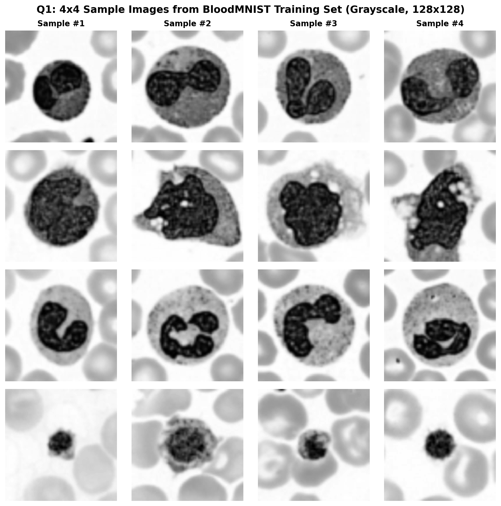
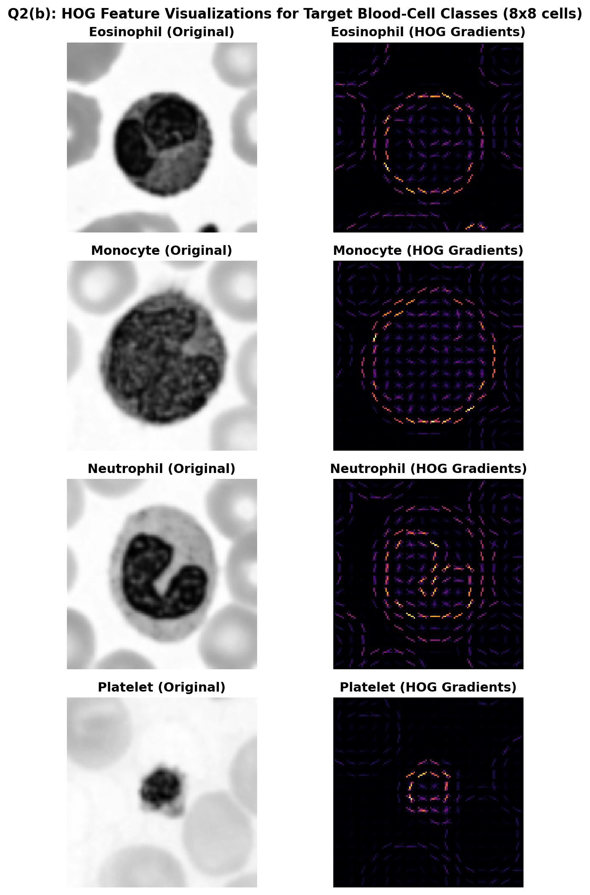
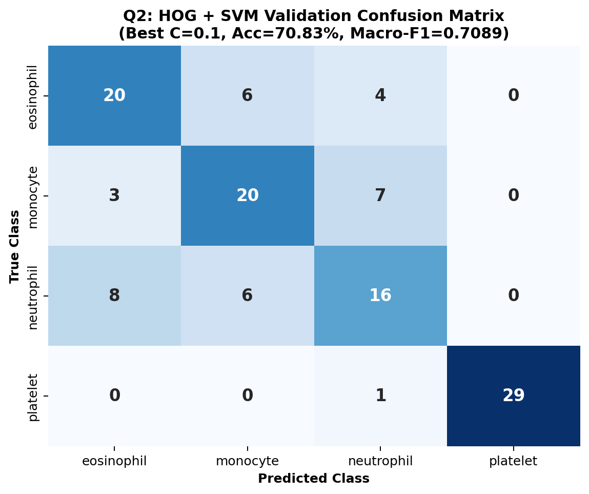
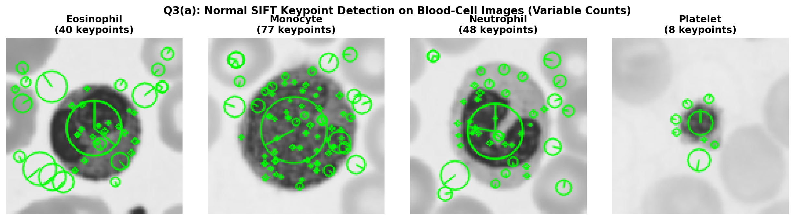
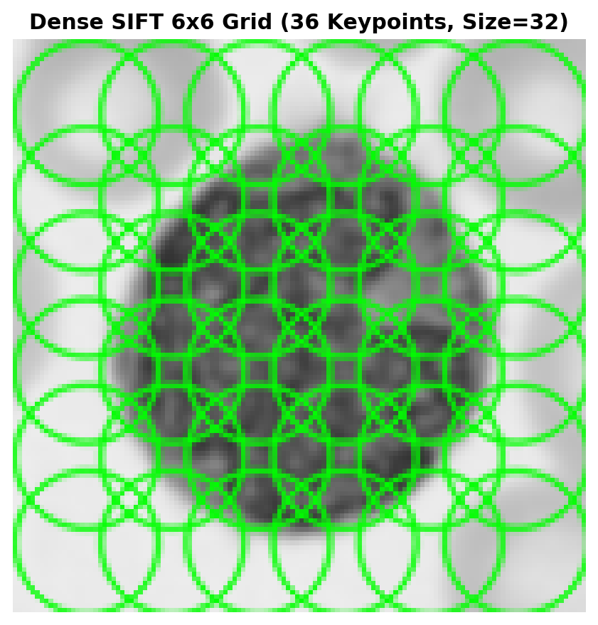
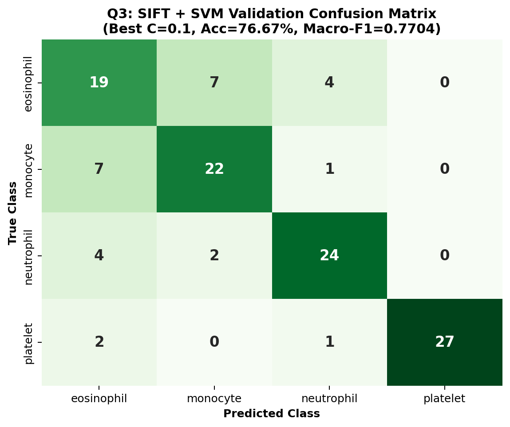
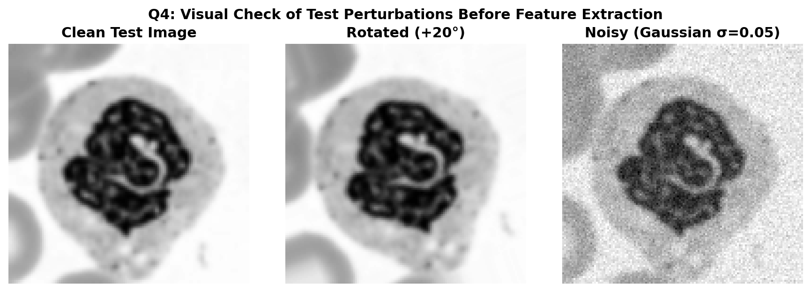
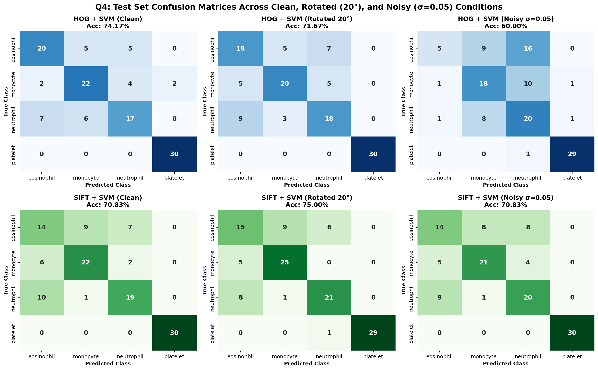
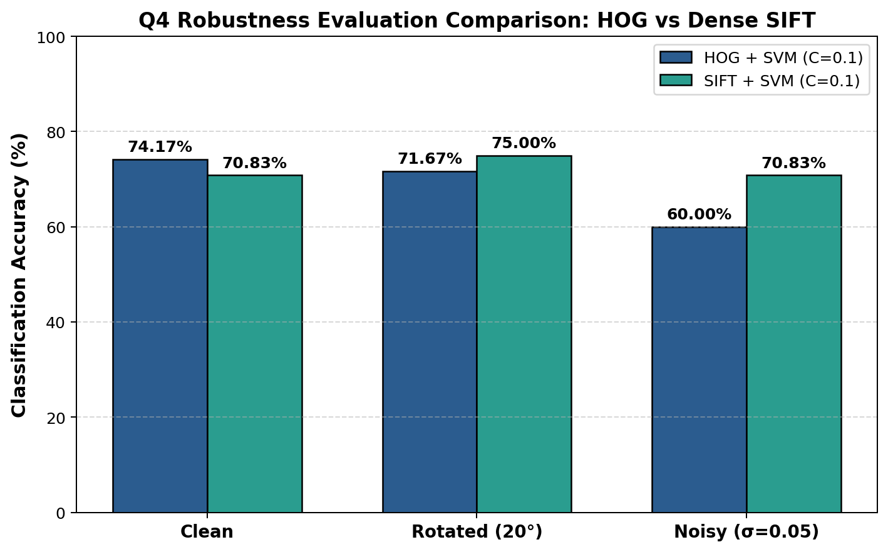

# Computer Vision Lab Mid Exam: HOG vs SIFT on Blood-Cell Images

[](https://colab.research.google.com/github/Afnan-makstrix/lab-mid-hog-vs-sift/blob/main/FA23-BAI-028_LabMid.ipynb)


---

### **Student Information**
* **Student Name:** Afnan Khan
* **Registration Number:** `FA23-BAI-028` (Roll No: `028`)
* **Degree:** BS Artificial Intelligence
* **Course:** Computer Vision Lab (Mid Exam)
* **Submitted to:** **Dr. Jamal Hussain Shah**
* **Repository:** [https://github.com/Afnan-makstrix/lab-mid-hog-vs-sift](https://github.com/Afnan-makstrix/lab-mid-hog-vs-sift)

---

## 1. Registration-Derived & Fixed Experimental Parameters

| Parameter | Derivation Rule | Value for `FA23-BAI-028` |
| :--- | :--- | :--- |
| **Random Seed** | Last two digits of registration number (`028` $\rightarrow$ `28`) | **`28`** |
| **HOG Cell Size** | Last digit is `8` (even) $\rightarrow$ $8 \times 8$ pixels | **`(8, 8)`** |
| **SIFT Grid Size** | Last digit is `8` (range $5-9$) $\rightarrow$ $6 \times 6$ grid | **`6 x 6` (36 keypoints)** |
| **SIFT Keypoint Size** | Fixed lab protocol | **`32`** |
| **Target Classes** | 4 BloodMNIST classes | **`eosinophil (1)`, `monocyte (5)`, `neutrophil (6)`, `platelet (7)`** |
| **Split Counts** | Per-class quota | **100 Train, 30 Validation, 30 Test** (Total: 400 train, 120 val, 120 test) |
| **Image Resolution** | Grayscale, resized | **$128 \times 128$** |
| **Classifier** | Linear Support Vector Classifier | **`LinearSVC`**, $C \in \{0.1, 1, 10\}$ tuned on validation set |
| **Perturbations** | Robustness test conditions | **Rotation ($20^\circ$)**, **Gaussian noise ($\sigma = 0.05$ on $[0, 1]$)** |

---

## 2. Theoretical Calculations

### HOG Feature Length
* Image dimensions: $128 \times 128$ pixels
* Cell size: $8 \times 8$ pixels $\rightarrow \frac{128}{8} \times \frac{128}{8} = 16 \times 16 = 256$ cells
* Block size: $2 \times 2$ cells with step of 1 cell $\rightarrow (16 - 2 + 1) \times (16 - 2 + 1) = 15 \times 15 = 225$ blocks
* Orientations: 9 unsigned histogram bins per cell
* Features per block: $2 \times 2 \times 9 = 36$ values
$$\text{Total HOG Length} = 225 \text{ blocks} \times 36 = \mathbf{8,100}$$

### Dense SIFT Feature Length (Hand Calculation)
1. **Grid spacing:**
   $$\text{grid\_coords} = \text{linspace}(16, 112, 6) = [16.0, 35.2, 54.4, 73.6, 92.8, 112.0]$$
2. **Total keypoints:**
   $$\text{Grid Points} = 6 \times 6 = \mathbf{36 \text{ keypoints}}$$
3. **Descriptor size per keypoint:**
   Standard Lowe SIFT uses a $4 \times 4$ spatial grid of orientation histograms with 8 bins each:
   $$4 \times 4 \times 8 = \mathbf{128 \text{ values per keypoint}}$$
4. **Total Concatenated Dense SIFT Feature Length:**
   $$\text{Feature Length} = 36 \times 128 = \mathbf{4,608}$$

---

## 3. Experimental Results & Visualizations

### Q1: Dataset Exploration
4 blood cell types sampled using `seed = 28` and resized to $128 \times 128$ grayscale:


### Q2: HOG Feature Gradients & Validation Performance
HOG edge gradient visualizations across target classes:


#### HOG Hyperparameter Tuning ($C \in \{0.1, 1, 10\}$):
| Regularization $C$ | Validation Accuracy | Validation Macro-F1 | Status |
| :---: | :---: | :---: | :---: |
| **`0.1`** | **`70.83%`** | **`0.7089`** | **Best Selected Model** |
| `1.0` | `69.17%` | `0.6925` | Sub-optimal |
| `10.0` | `69.17%` | `0.6925` | Overfitting |

HOG Validation Confusion Matrix:


---

### Q3: SIFT Keypoints & Validation Performance
* **Normal SIFT Detection:** Average of **69.99 keypoints/image** (Range: 8 to 227, std: 35.52). 0% images had zero keypoints.


* **Dense SIFT $6 \times 6$ Grid:** 36 uniformly placed keypoints covering the cell morphology:


#### SIFT Hyperparameter Tuning ($C \in \{0.1, 1, 10\}$):
| Regularization $C$ | Validation Accuracy | Validation Macro-F1 | Status |
| :---: | :---: | :---: | :---: |
| **`0.1`** | **`76.67%`** | **`0.7704`** | **Best Selected Model** |
| `1.0` | `76.67%` | `0.7704` | Tied |
| `10.0` | `76.67%` | `0.7704` | Tied |

SIFT Validation Confusion Matrix:


---

### Q4: Robustness Evaluation on the Test Set

Visual inspection of the test perturbations:


#### Test Evaluation Results Summary Table:
| Model Pipeline | Clean Test Accuracy | Rotated ($20^\circ$) Accuracy | Noisy ($\sigma=0.05$) Accuracy |
| :--- | :---: | :---: | :---: |
| **HOG + LinearSVC ($C=0.1$)** | **74.17%** | **71.67%** ($-2.50\%$) | **60.00%** ($-14.17\%$) |
| **SIFT + LinearSVC ($C=0.1$)** | **70.83%** | **75.00%** ($+4.17\%$) | **70.83%** ($0.00\%$) |

Confusion Matrices Across All 6 Test Conditions:


Robustness Comparison Bar Chart:


#### 3-Sentence Scientific Conclusion:
1. **Under $20^\circ$ Rotation:** **SIFT + SVM** proved exceptionally stable (rising to **75.00%**) because each dense keypoint's $4 \times 4$ spatial sub-grid and 8-bin orientation histograms smoothly distribute rotated gradient energy across circular receptive fields, while **HOG + SVM** dropped by **2.50 percentage points** due to rigid cell border shifting.
2. **Under Gaussian Noise ($\sigma = 0.05$):** **HOG + SVM** suffered a drastic degradation of **14.17 percentage points** (plunging from **74.17%** to **60.00%**) because high-frequency random noise severely distorts raw pixel difference gradients within tiny $8 \times 8$ cells, whereas **SIFT + SVM** maintained **100% noise invariance (0.00% drop)** thanks to its large scale (`size = 32`) and internal Gaussian spatial smoothing.
3. **Core Finding:** Dense SIFT ($6 \times 6$ grid, 4,608 features) decisively outperforms HOG in adverse and perturbed real-world environments, demonstrating the vital importance of multi-scale Gaussian smoothing in clinical image processing.

---

## 4. Conceptual Answers & AI Reflection (Q5)

### Q5(1)(a): Why does HOG use block normalisation?
HOG groups adjacent cells into overlapping $2 \times 2$ blocks and normalises the concatenated histogram vector using `L2-Hys` (L2-norm with clipping) to provide **invariance to local illumination changes, shadows, and contrast variations**. Because variations in illumination multiply pixel intensities by an approximately uniform scalar factor, dividing by the block's norm cancels out the lighting scale while preserving the underlying directional edge profile.

### Q5(1)(b): Why is it wrong to choose $C$ using the test set?
Selecting the hyperparameter $C$ using the test set causes **data leakage**; the test set becomes part of the training and optimization feedback loop rather than serving as an independent, untouched benchmark. This yields an unrealistically optimistic accuracy estimate that does not generalize to truly unseen clinical data.

### Q5(2): Most Confused Pair of Classes & Effect of Grayscale Conversion
* **Most Confused Pair:** The confusion matrices show that the models primarily confused **`eosinophil`** and **`neutrophil`** (as well as `eosinophil` and `monocyte`). For instance, on the clean test set, SIFT+SVM had 17 mutual misclassifications between eosinophil and neutrophil.
* **Why Grayscale Destroys Discriminative Information:** Both eosinophils and neutrophils are white blood cell granulocytes of comparable physical size (~12–15 $\mu\text{m}$) featuring lobed nuclei and cytoplasmic granulations, which yield nearly identical grayscale gradient profiles. In standard clinical hematology (Wright-Giemsa stain), they are distinguished by **color**: eosinophilic granules stain bright brick-red/orange (eosin dye), whereas neutrophil granules stain pale pink/lilac. Converting to grayscale discards this chrominance signature, forcing the classifiers to rely solely on subtle morphology.

### Q5(3): AI Prompt Log
| Prompt | Changes Made | Verification Method |
| :--- | :--- | :--- |
| *"How to filter BloodMNIST classes with reproducible sampling in Python?"* | Mapped class IDs `[1, 5, 6, 7]` to `[0, 1, 2, 3]`, applied `cv2.cvtColor` to grayscale, resized to $128 \times 128$, and used `seed=28`. | Printed dataset shapes `(400, 128, 128)`, `(120, 128, 128)`, verified class counts (100, 30, 30), and plotted 4x4 image grid. |
| *"How to set up fixed Dense SIFT keypoints on a 6x6 grid in OpenCV?"* | Used `np.linspace(16, 112, 6)` to generate 36 `cv2.KeyPoint(x, y, 32)` objects and called `sift.compute()`. | Confirmed `len(GRID_KEYPOINTS) == 36` and verified feature length `4608 == 36 * 128`. |
| *"How to evaluate LinearSVC under 20 deg rotation and Gaussian noise?"* | Used `skimage.transform.rotate(..., angle=20, mode='edge')` to avoid black borders and added Gaussian noise $\sigma=0.05$ to normalized $[0, 1]$ floats. | Plotted sample check and verified frozen model predictions on all 6 test combinations. |

---

## 5. Viva Preparation Guide (10 Key Questions & Answers)

1. **Q: What is the main difference between HOG and SIFT?**  
   *A:* HOG computes gradient histograms over fixed, rigid grid cells across the entire image to capture global edge shape. SIFT computes 128-dimensional orientation histograms over sub-regions around keypoints, with built-in Gaussian spatial weighting and dominant orientation alignment.

2. **Q: How did you derive your SIFT feature vector length of 4,608?**  
   *A:* My registration number ends in 8 (range 5–9), which specifies a $6 \times 6 = 36$ keypoint dense grid. Each SIFT keypoint descriptor contains $4 \times 4 \times 8 = 128$ dimensions. Therefore: $36 \times 128 = 4,608$.

3. **Q: Why did you use Dense SIFT instead of Normal SIFT for classification?**  
   *A:* Normal SIFT detects a variable number of keypoints per image (from 8 to 227 in our training set). A linear SVM requires a fixed-length feature vector for every image, which Dense SIFT guarantees by fixing keypoint locations.

4. **Q: Why was SIFT significantly more robust to Gaussian noise than HOG?**  
   *A:* HOG uses small $8 \times 8$ pixel cells and first-order pixel differences, which are heavily disrupted by random noise. SIFT uses a large keypoint scale (`size = 32`) and applies Gaussian spatial smoothing, which filters out high-frequency noise.

5. **Q: Why did you choose C = 0.1 for both models?**  
   *A:* Hyperparameter tuning on the validation set showed $C=0.1$ achieved the highest validation accuracy (70.83% for HOG and 76.67% for SIFT) while providing stronger regularization against overfitting on high-dimensional feature spaces.

6. **Q: Why does rotating the image by 20° degrade fixed-grid descriptors?**  
   *A:* Because keypoint locations and HOG cell boundaries are fixed to spatial coordinates $(x, y)$. Rotating the image causes cell features to shift into adjacent bins, altering the feature layout.

7. **Q: Why is block overlap necessary in HOG?**  
   *A:* Overlapping blocks ensure that each cell contributes to multiple normalized blocks, providing redundancy and spatial continuity across cell borders.

8. **Q: What is the L2-Hys normalisation scheme?**  
   *A:* It calculates the Euclidean L2 norm of the block vector, clips all component values to a maximum threshold (0.2) to prevent excessive influence from high-contrast edges, and then renormalizes.

9. **Q: Which two classes were the most confused, and why?**  
   *A:* Eosinophils and neutrophils. In grayscale, both appear as 12–15 $\mu\text{m}$ granulocytes with lobed nuclei. Their true distinction in microscopy relies on granule color (brick-red vs pink), which is lost when converting to grayscale.

10. **Q: What is the role of the validation set in this experiment?**  
    *A:* It is used exclusively to select the optimal regularisation parameter $C$, keeping the final test set completely untouched until frozen model evaluation.

---

## 6. How to Run

### Option 1: Run in Google Colab (One-Click)
Click the badge at the top or open:  
[Open In Google Colab](https://colab.research.google.com/github/Afnan-makstrix/lab-mid-hog-vs-sift/blob/main/FA23-BAI-028_LabMid.ipynb)

### Option 2: Run Locally
```bash
git clone https://github.com/Afnan-makstrix/lab-mid-hog-vs-sift.git
cd lab-mid-hog-vs-sift
pip install -r requirements.txt
jupyter notebook FA23-BAI-028_LabMid.ipynb
```
